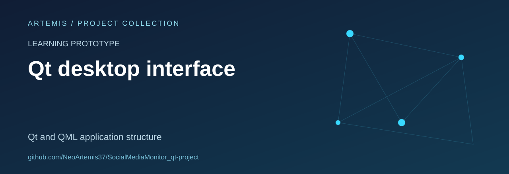

# Social Media Monitor UI Study

A Qt desktop learning project focused on an animated welcome screen, registration/login views and local database interaction.

**Status:** interface prototype. **Stack:** C++17, Qt Quick/QML, Qt SQL, SQLite and CMake.

## What the snapshot contains

- A C++ entry point that exposes a database object to QML.
- Welcome-screen and registration/login components.
- Database methods for user existence, registration and login.
- A small HTML page and existing visual assets.

This snapshot does not establish a complete social-media monitoring backend, platform integrations or an operational analytics service.

## Project map

| File | Role |
| --- | --- |
| `CMakeLists.txt` | Build target named `Leolio` |
| `main.cpp` and `main.qml` | Application entry points |
| `MainContent.qml` | Welcome screen |
| `Registration.qml` | Registration/login interface |
| `database.cpp` and `database.h` | Local database integration |
| `qml.qrc` | Resource declarations |

## Development environment

Open `CMakeLists.txt` in a Qt-capable IDE. The project declares CMake 3.16 or later, C++17, and Qt Core, Quick and Sql components, with Qt 5/6 build branches. Cross-version compatibility has not been verified by this repository.

## Current limits and next steps

Treat the authentication code as a learning implementation. A production credential-handling model has not been established. Build outputs and a local `users.db` are tracked under `build/`; use fresh synthetic data for demonstrations and remove local runtime artefacts from future source commits after review.

Useful next steps are a reproducible build, source-only repository hygiene, interface tests and a clear choice between a UI study and a separately specified monitoring application.

No repository-wide licence file is currently included. The origin and reuse terms of the artwork should also be documented.
